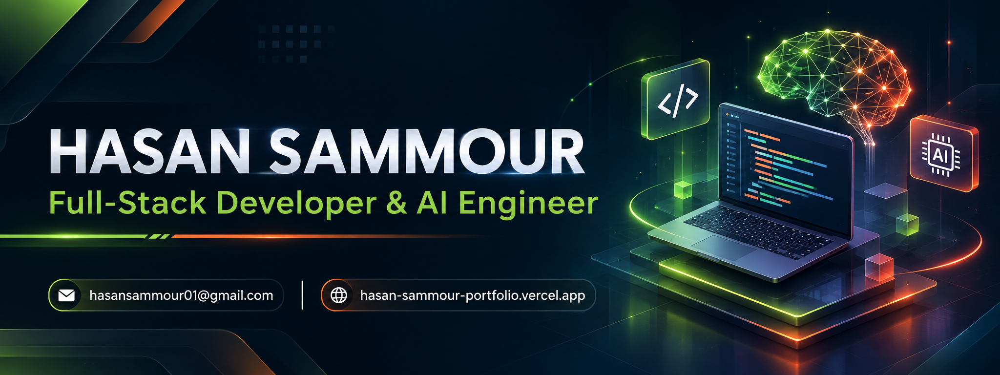
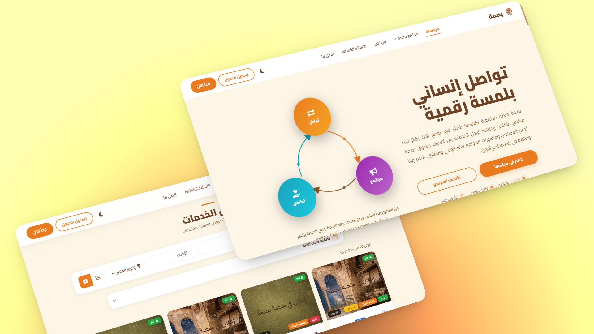
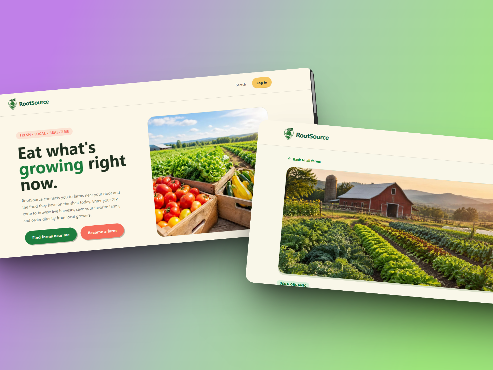
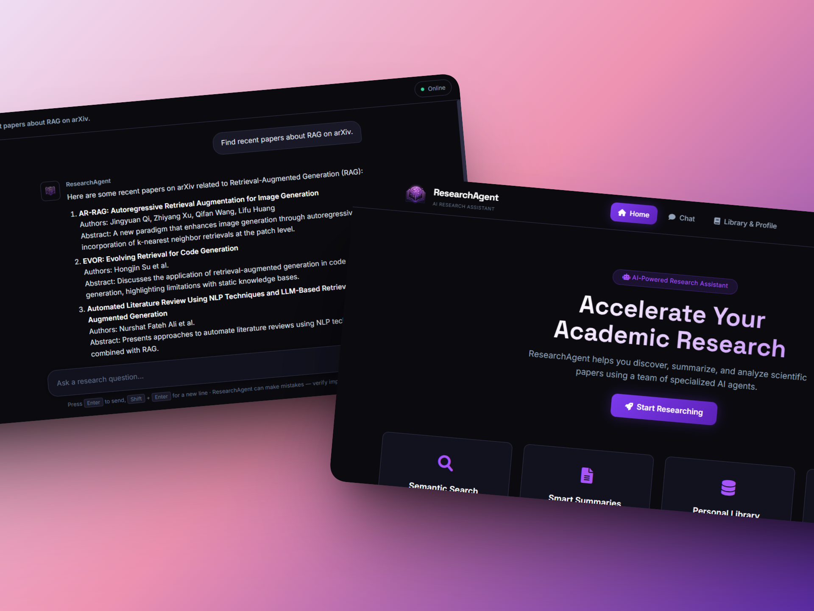

  

<h1 align="center">Hi there, I'm Hasan Sammour 👋</h1>
<h3 align="center">Full-Stack Developer & AI Engineer | Team Lead</h3>

  <a href="https://linkedin.com/in/hasan-sammour-72657a3a1/"><b>LinkedIn</b></a> •
  <a href="https://hasan-sammour-portfolio.vercel.app/"><b>Portfolio</b></a> •
  <a href="mailto:hasansammour01@gmail.com"><b>Email</b></a>

  

---

### 🚀 About Me

I am a Computer Engineering graduate from Gaza, Palestine, specializing in building secure, scalable web applications and integrating AI agents. I don't just write code; I architect solutions that bridge the gap between complex backends and seamless user experiences.

- 🔭 I’m currently building **Basma** (a privacy-first platform with 148+ APIs and AES-256 encryption).
- 🤖 I recently developed **ResearchAgent**, a multi-expert AI system featuring hybrid search and human-in-the-loop safety.
- 💼 I have leadership experience as a **Team Lead**, coordinating cross-functional teams in remote Agile environments.
- 🎧 I am **Zendesk Certified** (Agent & Explore Analytics), bringing a strong customer-centric mindset to my engineering.
- 🌍 Open to **Remote** or **On-site** opportunities in Full-Stack Development, AI Engineering, or Technical Support.

---

### 🛠️ Tech Stack & Tools

   
  
    

---

### 💼 Featured Projects

<table border="0" width="100%">
  <tr>
    <td width="33%" valign="top">
      <h3 align="center">Basma Platform</h3>
      

        
        

          Privacy-first community platform. 
          <b>Laravel, React, AES-256</b>
        

        

          <a href="https://basmagaza.vercel.app/"><b>Live Demo</b></a> | 
          <a href="https://github.com/Basma-Platform"><b>Source Code</b></a>
        

      

    </td>
    <td width="33%" valign="top">
      <h3 align="center">RootSource</h3>
      

        
        

          Farm-to-consumer platform. 
          <b>Next.js, Prisma, PostgreSQL</b>
        

        

          <a href="https://v62-rootsource.netlify.app/"><b>Live Demo</b></a> | 
          <a href="https://github.com/chingu-voyages/V62-tier3-team-32"><b>Source Code</b></a>
        

      

    </td>
    <td width="33%" valign="top">
      <h3 align="center">ResearchAgent AI</h3>
      

        
        

          Multi-expert AI system. 
          <b>Python, Flask, Agno</b>
        

        

          <a href="https://github.com/HasanSammour/ResearchAgent"><b>Source Code</b></a>
        

      

    </td>
  </tr>
</table>

---

### 📊 GitHub Analytics

  <!-- GitHub Stats -->
  
  
  <!-- Top Languages -->
  

 

  <!-- GitHub Streak -->
  

---

  <i>Let's connect and build something impactful.</i>

